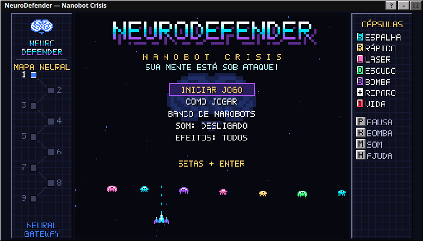
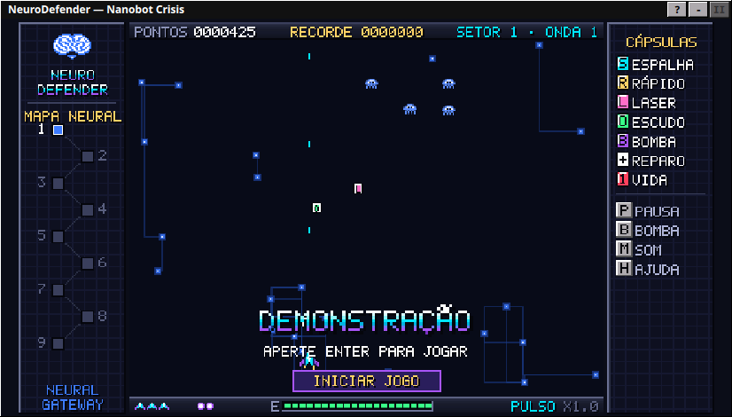
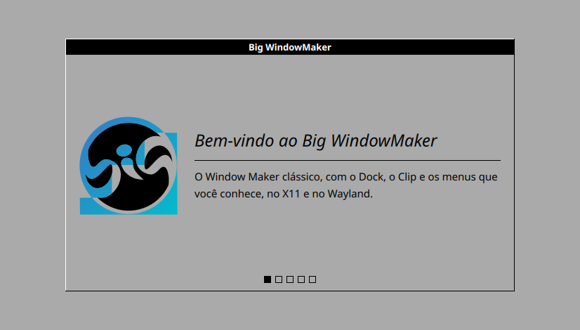
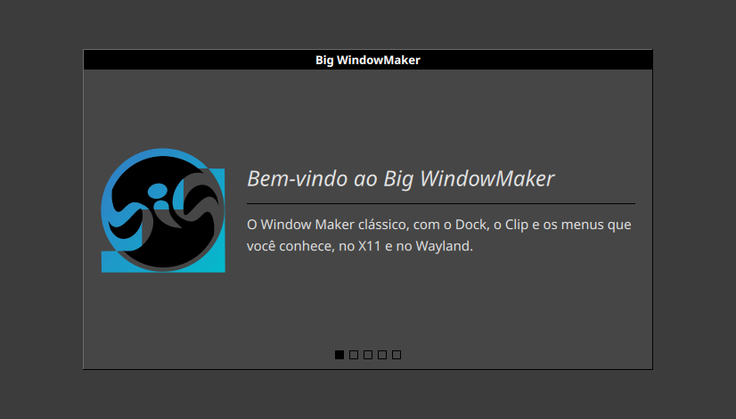
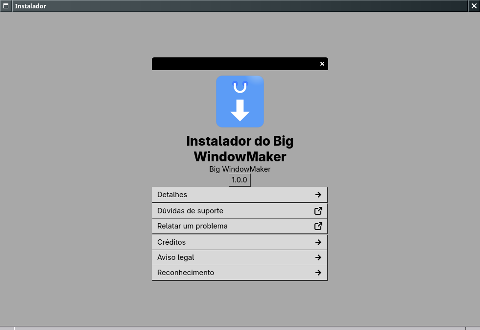

<p align="center">
  
</p>

<h1 align="center">biglinux-livecd — edição Big WindowMaker</h1>

<p align="center">
  <b>A sessão live e o instalador do BigLinux, com o perfil do Big WindowMaker.</b><br>
  Fork de <a href="https://github.com/biglinux/biglinux-livecd">biglinux/biglinux-livecd</a>; as mudanças são propostas ao projeto original.
</p>

<p align="center">
  
  <a href="https://github.com/biglinux/biglinux-livecd"></a>
  
</p>

<p align="center">
  <a href="#o-que-este-fork-muda">O que muda</a> ·
  <a href="#capturas">Capturas</a> ·
  <a href="#o-instalador-do-big-windowmaker">Instalador</a> ·
  <a href="#neurodefender-o-jogo-da-instalação">NeuroDefender</a> ·
  <a href="#sessão-live-startbiglive-e-wdm">Sessão live</a> ·
  <a href="#pacote">Pacote</a> ·
  <a href="#testes">Testes</a> ·
  <a href="#contribuir">Contribuir</a> ·
  <a href="#créditos-e-agradecimentos">Créditos</a> ·
  <a href="#biglinux-livecd">Documentação original (English)</a>
</p>

## O que este fork muda

O `biglinux-livecd` é o que roda entre ligar o pendrive e ter o sistema
instalado: a sessão live, o assistente de idioma, teclado e aparência, e o
assistente do Calamares. Este fork acrescenta, sem mexer nas outras edições:

| Mudança | Onde |
|---|---|
| **Perfil `bigwindowmaker`** do instalador: nome, logomarca, ilustração de boas-vindas, barra lateral cinza, páginas próprias e cores do Big WindowMaker | `usr/share/biglinux/calamares-profiles/bigwindowmaker/` |
| **NeuroDefender**, arcade de 1997 na etapa de instalação, com a apresentação OPENSTEP como reserva | `branding/bigwindowmaker/BigWindowMakerSlides.qml`, `neurodefender/` |
| **Visual do Window Maker no instalador**: as janelas GTK com o tema da sessão (OneStepBack) e a barra de título do Window Maker (`gtk-nocsd`), o Calamares com o tema QTStep do Kvantum da sessão, claro ou escuro | `usr/lib/biglinux-livecd/window-maker-look`, `calamares-biglinux`, `calamares-biglinux_polkit` |
| **Sessão live do Window Maker**: o `startbiglive` abre o `startbigwm` (X11) ou o `startbigwm-wayland` e reconhece o **wdm** como gerenciador de login | `usr/bin/startbiglive` |
| **wdm no sistema instalado**: o módulo `services` habilita o `wdm` antes de sddm, gdm e lightdm; edições sem wdm não mudam | `modules/services.conf` dos perfis |
| **Sobre pelo perfil da edição**: o `profile.json` pode trazer um bloco `about`; no `bigwindowmaker`, "Instalador do Big WindowMaker", com os mantenedores, o BigLinux creditado como projeto original e a versão do pacote. BigLinux, BigCommunity e XivaStudio continuam com o Sobre do BigLinux | `profile.json`, `tests/test_about_profile.py` |

## Capturas

<table>
  <tr>
    <td width="50%"></td>
    <td width="50%"></td>
  </tr>
  <tr>
    <td align="center"><sub>NeuroDefender na etapa de instalação: menu inicial</sub></td>
    <td align="center"><sub>Depois de 14 s parado, o modo demonstração</sub></td>
  </tr>
  <tr>
    <td></td>
    <td></td>
  </tr>
  <tr>
    <td align="center"><sub>Apresentação de reserva, tema claro (QTStepOpenStep)</sub></td>
    <td align="center"><sub>Tema escuro (QTStepOpenStepDark)</sub></td>
  </tr>
</table>

<sub>Capturas de 14/11/2026 da área da apresentação (826×470, o tamanho que o
Calamares dá a ela), com o QML do perfil num `qml` do Qt 6 em Xvfb e o tema
Kvantum da sessão.</sub>

<p align="center">
  <br>
  <sub>Sobre do assistente de instalação no perfil <code>bigwindowmaker</code></sub>
</p>

Na ISO de teste (Alpha, máquina virtual, 06/11/2026):

| | |
|---|---|
|  |  |
| Assistente da sessão live | Instalador: particionamento |
|  |  |
| Instalador: usuário | Instalador: resumo |

## O instalador do Big WindowMaker

A ISO escolhe o perfil pelo arquivo `/etc/biglinux-livecd/profile` (o
[iso-profiles](https://github.com/big-windowmaker/iso-profiles) grava
`bigwindowmaker`). O atalho de instalação abre primeiro o assistente GTK
(`/usr/share/biglinux/calamares`: aviso de UEFI, opções, dicas) e depois o
Calamares com o perfil.

| Etapa | Módulos do `settings.conf` |
|---|---|
| Páginas | `welcomeq` → `locale` → `keyboard` → `partition` → `usersq` → `summaryq` |
| Instalação | `partition`, `luks-pbkdf`, `mount`, `unpackfs`, `networkcfg`, `machineid`, `fstab`, `locale`, `keyboard`, `packages`, `localecfg`, LUKS, `initcpiocfg`, `initcpio`, `usersq`, `displaymanager`, `mhwdcfg`, `hwclock`, `services`, `grubcfg`, `bootloader`, `grubcfg-fix`, `postcfg`, `btrfs-fix`, `umount` |
| Fim | `finishedq` |

| Branding (`branding.desc`) | |
|---|---|
| Janela | 1000×600, centralizada; barra lateral e navegação em QML |
| Barra lateral | cinza `#AEAAAE`, etapa atual `#525252` com texto branco |
| Apresentação | `BigWindowMakerSlides.qml` (API 2: `onActivate`/`onLeave`) |
| Links | suporte e problemas em [big-wm/issues](https://github.com/big-windowmaker/big-wm/issues), notas em [build-iso/releases](https://github.com/big-windowmaker/build-iso/releases) |

**Temas.** No Big WindowMaker o `calamares-biglinux_polkit` passa ao root só
os nomes que leu na sessão (`BIGLINUX_BIG_WM`, `BIGLINUX_GTK_THEME`,
`BIGLINUX_GTK_NOCSD`, `BIGLINUX_KVANTUM_THEME`); o `window-maker-look`
confere cada um contra o que está instalado (tema com `gtk-4.0`, biblioteca
do `gtk-nocsd` do root, tema Kvantum existente) e só então os usa. O
Calamares abre com o tema QTStep da sessão e um `kdeglobals` com as mesmas
cores, claro ou escuro; um tema de outro desktop vira o `QTStepOpenStep`.
Fora do Big WindowMaker nada disso se aplica.

## NeuroDefender, o jogo da instalação

Na etapa **Instalar**, a área da apresentação vira um arcade de tiro vertical
no estilo dos sharewares de 1997: 9 setores do cérebro com chefes, nanobots
que evoluem, cápsulas, modo demonstração, português e inglês. A instalação
não espera o jogo: a barra de progresso e o status do Calamares continuam
embaixo. O jogo só é carregado no `onActivate()`; se não carregar ou parar
com erro, voltam os slides OPENSTEP. O som (QtMultimedia, opcional) começa
desligado.

Controles, regras, arquitetura, testes e medições:
[docs/neurodefender](docs/neurodefender/README.md). Para jogar fora do
instalador:

```sh
/usr/lib/qt6/bin/qml tools/neurodefender-play.qml
```

## Sessão live: startbiglive e wdm

1. A ISO inicia o **wdm**; na live, o usuário é `bigwindowmaker`, senha
   `big`, e a sessão padrão é *Big WindowMaker Live*, que executa o
   `startbiglive`. Vale a partir da próxima ISO: as publicadas até
   12/11/2026 entram sozinhas pelo LightDM, com o usuário `community`
   (senha `big`).
2. O `startbiglive` identifica o gerenciador de login pelo
   `display-manager.service` (sddm, gdm, lightdm, lxdm ou **wdm**), protege
   contra loop de login, espelha os monitores no X11 e abre o assistente
   (GTK 4: idioma, teclado, tema claro ou escuro), com o renderizador cairo
   em VM e no Mesa amber, a mesma regra da sessão do Big WindowMaker.
3. Concluído o assistente, executa o `startbigwm` (X11) ou, numa sessão
   Wayland, o `startbigwm-wayland`.
4. Na instalação, as escolhas do assistente vão para
   `/etc/big-default-config` e o Calamares habilita o `wdm` no sistema
   instalado.

## Pacote

O pacote da ISO é compilado pelo
[big-windowmaker/packages](https://github.com/big-windowmaker/packages/tree/main/biglinux-livecd),
fixado num commit do `main` deste fork, e entra na camada live da ISO
(`Packages-Live`). O [`pkgbuild/PKGBUILD`](pkgbuild/PKGBUILD) daqui é o do
upstream (compila a partir de `biglinux/biglinux-livecd`), com as mesmas
dependências da receita do `packages`. Para testar, baixe a ISO em
[build-iso/releases](https://github.com/big-windowmaker/build-iso/releases) e
inicie numa máquina virtual.

| Dependência | Para quê |
|---|---|
| `calamares`, `qefientrymanager` | o instalador e as entradas UEFI |
| `gtk4`, `libadwaita`, `python-gobject`, `python-cairo`, `python-babel`, `circle-flags` | os assistentes GTK e as bandeiras dos idiomas |
| `glib2` | `gsettings`, `gdbus` e `gio` nos scripts da sessão live |
| `xorg-setxkbmap`, `xorg-xrandr` | teclado e monitores da sessão X11 |
| `btrfs-progs`, `e2fsprogs`, `mtools`, `util-linux` | sistemas de arquivos, `findmnt`/`lsblk` |
| opcionais: `speech-dispatcher`, `openssh`, `shadow`, `qt6-multimedia` | leitura de tela no assistente, `sshenable`, som do NeuroDefender |

## Testes

```sh
python -m pytest tests          # perfis, Calamares, Sobre, NeuroDefender, segurança, traduções
ruff check . && ruff format --check .
```

`tests/test_bigwindowmaker_profile.py` cobre o perfil (nomes, arte,
apresentação e cores, YAML válido, contraste AA dos textos e o perfil
`bigcommunity` intocado), `tests/test_installer_window_maker_look.py` o
visual do Window Maker no instalador e `tests/test_neurodefender.py` o jogo (motor no Node,
`qmltestrunner`, `qmllint` e um `QQuickWidget` como o do Calamares).
`test_language_suggestion` precisa do `python-babel` e
`test_mypy_plugins` do `mypy`.

## Contribuir

Mudanças que valem para todas as edições devem ir primeiro ao
[projeto original](https://github.com/biglinux/biglinux-livecd); aqui ficam
as do Big WindowMaker e as que ainda esperam o upstream. Problemas da ISO:
[big-windowmaker/build-iso](https://github.com/big-windowmaker/build-iso/issues).
Guia: [CONTRIBUTING](https://github.com/big-windowmaker/.github/blob/main/CONTRIBUTING.md).

## Créditos e agradecimentos

**Projeto original — BigLinux:** Bruno Gonçalves
([@bigbruno](https://github.com/bigbruno)), Tales A. Mendonça
([@talesam](https://github.com/talesam)),
([@eltonfabricio10](https://github.com/eltonfabricio10)),
[@LordDan78](https://github.com/LordDan78) e a equipe do BigLinux.

**Mantenedores do Big WindowMaker:** Rafael Ruscher <rruscher@gmail.com> e
Barnabé Di Kartola <barnabedikartola@gmail.com>.

**Agradecimentos especiais:** Alfredo Kojima (pelo
[Window Maker](https://www.windowmaker.org/)), Philipp Kaeser (pelo
[wlmaker](https://github.com/phkaeser/wlmaker)), Bruno Gonçalves (pelo
[BigLinux](https://www.biglinux.com.br/)) e Tales A. Mendonça (pela
[BigCommunity](https://communitybig.org)).

---

# biglinux-livecd

BigLinux live-session setup and Calamares installer integration.

This package is what runs between powering on the live media and having an
installed system: it starts the live desktop, offers a wizard to pick language,
keyboard and appearance before that desktop appears, and carries those choices
into the installation performed by Calamares.

## What the package provides

**Live session bootstrap.** `startbiglive` prepares the display manager and the
monitor layout, runs the setup wizard and then hands over to the desktop
session. `livecd-tweaks` applies the tweaks a live session needs before the user
arrives, including the ones requested through kernel arguments.

**Setup wizard** (`/usr/share/biglinux/livecd`, GTK4 and libadwaita). Choices are
written to `/tmp` under the names listed in `usr/lib/biglinux-livecd/live-state`,
which is the single place that maps a setting to its file. Calamares copies them
into `/etc/big-default-config` so the installed system starts as the live session
was left.

**Installer integration.** `calamares-biglinux` is the wrapper that launches
Calamares with the right profile and environment, and
`/usr/share/biglinux/calamares` is the GTK wizard that collects the installation
options before it starts.

**Calamares profiles** for the four products built from this base — `biglinux`,
`bigcommunity`, `xivastudio` and `bigwindowmaker` — each with its own
`settings.conf`, module configuration and branding. `bigwindowmaker` (the Big
WindowMaker image) has its own logo, welcome illustration, gray sidebar and
installation-step slideshow (`BigWindowMakerSlides.qml`: the NeuroDefender
arcade game, with classic OPENSTEP slides as the fallback), and enables wdm
on the installed system; its modules started as a copy of `bigcommunity`'s and
are kept in step by hand.

**Calamares modules** under `usr/lib/calamares/modules`:

| Module | Purpose |
|---|---|
| `btrfs-fix` | Applies the Btrfs layout and mount options the installed system expects |
| `grubcfg-fix` | Adjusts the generated GRUB configuration |
| `luks-pbkdf` | Lowers the Argon2id cost of the volume GRUB unlocks, so the passphrase prompt answers quickly |

## Configuration storage

The wizard writes state files to `/tmp` during the live session. On install,
`biglinux-install-setup.sh` copies them into `/etc/big-default-config/`, renaming
each one. A missing file means "not selected": `copy_live_config` skips it.

| Live session | Installed system | Description |
|---|---|---|
| `/tmp/big_language` | applied directly | System locale (for example, `pt_BR`) |
| `/tmp/big_keyboard` | `kxkbrc`, `fcitx5/` | Keyboard model and layout |
| `/tmp/big_desktop_theme` | `theme` | Selected visual theme |
| `/tmp/big_desktop_changed` | `desktop` | Desktop layout preset |
| `/tmp/big_gnome_layout` | `gnome-layout` | GNOME layout preset |
| `/tmp/big_gnome_settings` | `gnome-settings` | GNOME dconf settings |
| `/tmp/big_enable_jamesdsp` | `jamesdsp` | Audio enhancement state |
| `/tmp/big_improve_display` | `display-profile` | ICC colour profile state |

`/run/biglinux-live/` is a different directory, used only by the Calamares and
integrity helpers — not for the wizard's choices.

The map of every setting to its file is
[`usr/lib/biglinux-livecd/live-state`](biglinux-livecd/usr/lib/biglinux-livecd/live-state).

## Live profiles

The active profile is named in `/etc/biglinux-livecd/profile`, which must be a
regular root-owned file. `resolve-profile` reads it and returns the profile
directory, preferring `/etc/biglinux-livecd/calamares-profiles` over the ones
shipped in `/usr/share/biglinux/calamares-profiles`, so an image can override a
profile without replacing this package. Without the marker the profile is
`biglinux`.

## Kernel arguments

Recognised on the live media's boot line:

| Argument | Effect |
|---|---|
| `biglinux.bootcmd=<command>` | Skips the normal flow. Accepts `only-calamares`, `boot-in-plasma`, `only-konsole`, `calamares_polkit`, `konsole`, `urxvt` and `startplasma-x11` |
| `driver=nonfree` | Installs the runtime mkinitcpio shim for proprietary drivers |
| `driver=free` | Disables proprietary driver detection |
| `wayland` | Starts the session under Wayland |
| `sshenable` | Enables the live SSH server for recovery |

These arguments are dropped from the command line written to the installed
system, so a choice made to get through the live session is not inherited.

### sshenable

Useful when a machine cannot be operated locally — a failing boot, or a display
that does not come up. It sets a temporary password on the existing UID 1000
user, whose name is read from `/etc/passwd` and is usually `biglinux`, and adds a
runtime drop-in to `sshd_config` allowing password authentication for that user
only. The password is `big`, `PermitRootLogin` stays `no`, and no account is
created or otherwise modified.

```bash
ssh <live-user>@<live-address>
```

The password is public, so this is for a trusted local network and never for a
machine reachable from the Internet. Everything is in effect only while the live
session runs: reboot without the argument and nothing remains, and nothing is
written to the installed system.

## Repository layout

```
biglinux-livecd/         files installed on the system, mirroring their paths
  locale/                gettext catalogs, compiled at package time
  usr/bin/               live session entry points and installer wrappers
  usr/lib/biglinux-livecd/   shared shell helpers: kernel-options, live-state
  usr/lib/calamares/modules/ Calamares job modules
  usr/share/biglinux/livecd/     setup wizard
  usr/share/biglinux/calamares/  installer wizard
  usr/share/biglinux/calamares-profiles/  per-product Calamares profiles,
                                         each with its own QML branding
pkgbuild/                PKGBUILD and install scriptlet
tests/                   test suite
```

## Development

Requires an Arch or Manjaro based system, Python 3.11 or newer, and GTK4 with
libadwaita.

```bash
python -m pytest tests/      # test suite
ruff check                   # lint
ruff format --check          # formatting
```

All three pass on a clean checkout, so a failure means the change under review.

The test suite is the quality gate. Besides covering behaviour, it type-checks
the Calamares modules and the two wizards by running `mypy` against each entry
point in the isolation Calamares itself uses — a plugin is loaded as a standalone
module named `main`, so checking them together reports false duplicates. Adding a
module means adding it to the list in `tests/test_mypy_plugins.py`; a test fails
if an entry point is left out.

Shell scripts are checked with `shellcheck` and `shfmt -d`, syntax-checked with
the interpreter each one declares — most are `bash`, a few are POSIX `sh`.

Building the package:

```bash
cd pkgbuild
makepkg -si
```

`makepkg` builds from the published git repository, not from the working tree.
To try local changes, copy them into a live session or install the built package
over an existing one.

## Translations

Sources are the `.po` files in `biglinux-livecd/locale`, compiled by the PKGBUILD
into `/usr/share/locale`. `msgfmt --check-format` runs during the build, so a
catalog whose placeholders do not match its source fails the package rather than
the running program.

## Credits

Original project: BigLinux (Bruno Gonçalves, Tales A. Mendonça and the
BigLinux team). Big WindowMaker edition: Rafael Ruscher
<rruscher@gmail.com> and Barnabé Di Kartola <barnabedikartola@gmail.com>.

## License

GPL-3.0-only, with CC0-1.0 material. See [LICENSE](LICENSE).
