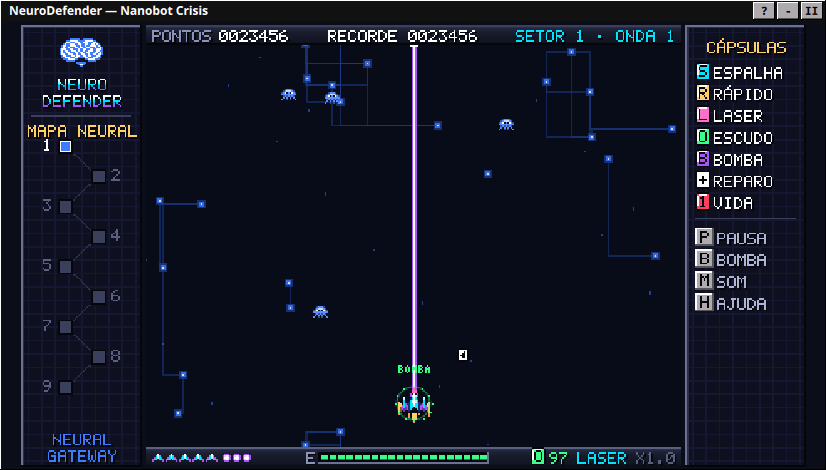
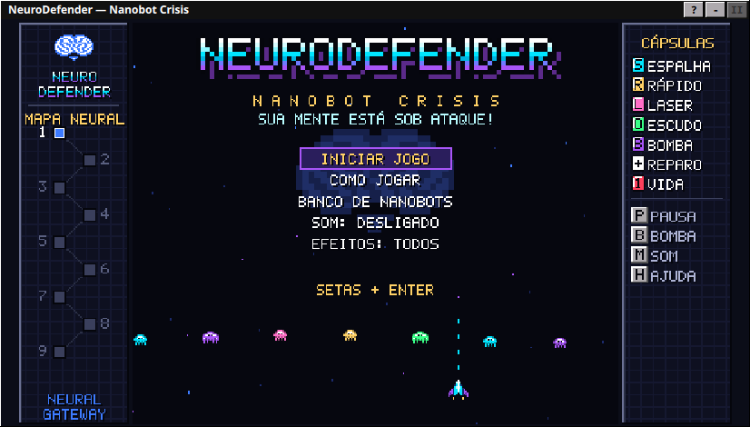
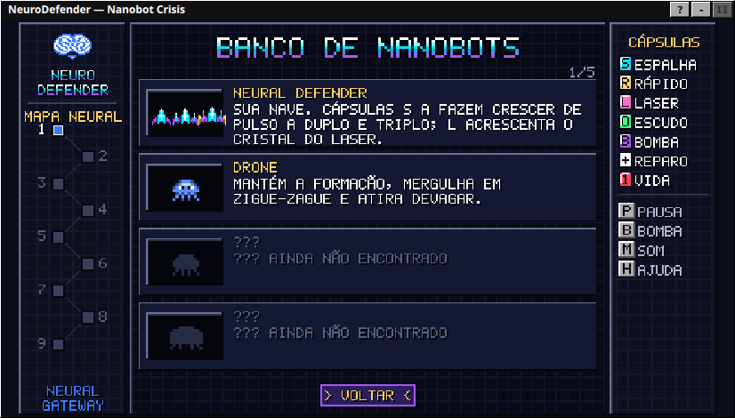
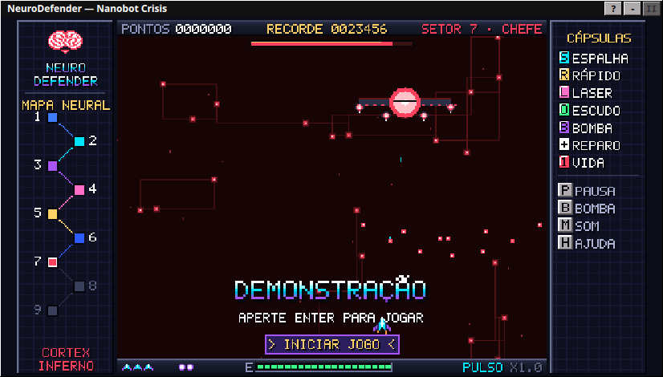
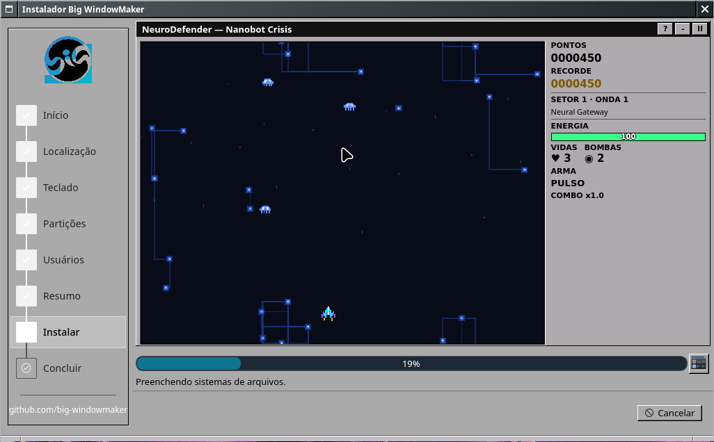
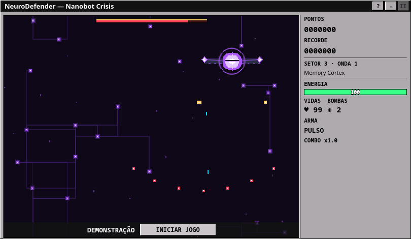
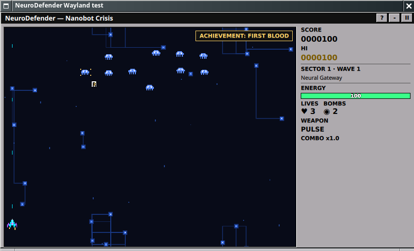

# NeuroDefender: Nanobot Crisis

*"Defend Your Mind. Destroy the Nanobots."*

Arcade de tiro vertical no estilo dos sharewares de 1997, mostrado na etapa
**Instalar** do instalador do Big WindowMaker (perfil `bigwindowmaker` do
Calamares). A instalação segue sozinha: a barra de progresso e a mensagem de
status reais do Calamares ficam embaixo da área do jogo.

| | |
|---|---|
|  |  |
|  |  |
|  |  |

## Para quem joga

| Ação | Teclado / mouse |
|---|---|
| Mover | Setas ou WASD (a nave fica no quarto de baixo da arena) |
| Atirar | Espaço ou botão esquerdo (segure) |
| Guiar até o ponteiro | Segure o botão esquerdo sobre a arena |
| Bomba de pulso neural | B ou botão direito |
| Pausa | P (ou o botão II da barra de título) |
| Som | M (desligado por padrão) |
| Como jogar | H |
| Menus | Setas e Enter, ou o mouse (passe por cima e clique) |
| Páginas do Banco de Nanobots | ← → |
| Iniciar / jogar de novo | Enter |

A arena só recebe o teclado quando tem o foco (um clique nela, ou Tab):
as teclas continuam funcionando normalmente no resto do instalador.

- **Campanha:** 9 setores do cérebro, cada um com 3 ondas e um chefe
  (Mega-Nanobot). Depois dos chefes dos setores 2, 4, 6 e 8 vem um
  *Desafio Neural*, uma onda bônus em que ninguém atira.
- **Nanobots que evoluem:** cada setor apresenta um comportamento novo
  (clonagem, escudo frontal, camuflagem, teletransporte, mergulho kamikaze,
  ataque coordenado, regeneração), e o último, The Neural Core, combina os
  comportamentos. Os detalhes estão em [02-jogo-e-ia.md](02-jogo-e-ia.md).
- **Cápsulas:** S (tiro espalhado), R (tiro rápido), L (laser neural),
  O (escudo), B (bomba), + (reparo) e 1 (vida). A letra identifica cada uma
  sem depender da cor.
- **Nave que evolui:** a primeira cápsula S dá canhões laterais, a segunda
  asas douradas e tiro triplo; o tiro rápido aumenta as chamas e o laser
  acende um cristal no nariz da nave.
- **Extras:**
  - combo de até ×4 e bônus por quase acerto (*near miss*);
  - dificuldade que se adapta ao jogador;
  - 6 conquistas e o Banco de Nanobots (enciclopédia do que já apareceu);
  - aviso *WARNING! MEGA-NANOBOT DETECTED* antes dos chefes;
  - recorde guardado na memória enquanto o instalador está aberto.
- **Modo demonstração:** depois de 14 s parado no título, a nave joga
  sozinha. Enter ou INICIAR JOGO devolvem o controle.
- **Idiomas e efeitos:** português e inglês, conforme o idioma escolhido no
  instalador. A opção EFEITOS: MÍNIMOS tira partículas e animações de fundo.

## Documentos

- [01-arquitetura-e-integracao.md](01-arquitetura-e-integracao.md): arquivos,
  ciclo de vida no Calamares, apresentação de reserva e empacotamento.
- [02-jogo-e-ia.md](02-jogo-e-ia.md): regras, armas, a evolução dos nanobots
  e os chefes.
- [03-testes-e-desempenho.md](03-testes-e-desempenho.md): testes, medições
  reais e validação em VM.

## Limitações conhecidas

- **Som:** o Calamares roda como root, então o QtMultimedia pode não alcançar
  o servidor de áudio do usuário do live. Nesse caso o jogo segue em
  silêncio. O som saindo pelo instalador **não foi verificado**.
- **Recorde:** só fica na memória. Nada é gravado em disco, nem no live nem
  no sistema instalado.
- **Teste no Wayland:** o jogo foi testado no Wayland (wlmaker) numa janela
  Qt nativa. Uma instalação completa pelo Calamares foi feita só na sessão X11.
